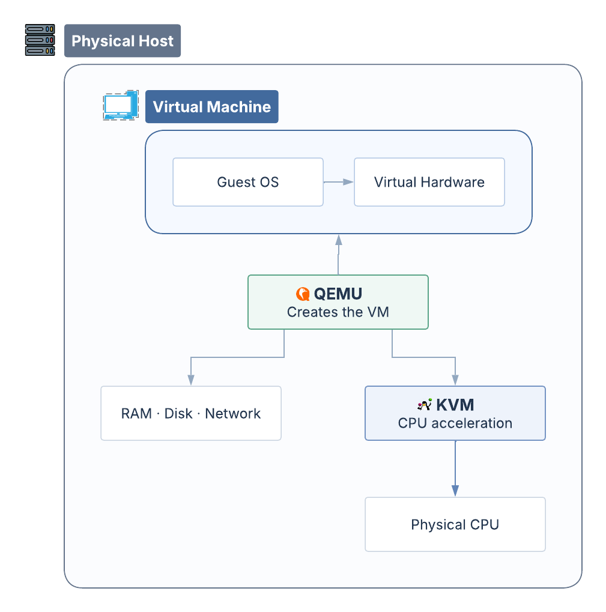

*Under the Hood #01 — QEMU, KVM, and the Magic Behind Virtual Machines.*

Have you ever imagined a computer coming to life without a single screw?

No new motherboard. No extra RAM. Not even another processor. And yet, with just a few steps, another computer begins to boot up inside the first one. It has its own virtual CPU, memory, storage, and operating system. It can access the internet, run applications, and even reboot—all without restarting the physical computer.

<!-- truncate -->

You look around the room. There's no other computer in sight. Everything looks just as it did before. On your screen, a new window appears. Inside it, another operating system is running. Behind it all is a program called **QEMU**.

Rather than building a computer out of physical components, QEMU can create a virtual computer entirely in software. A virtual machine's hard drive can be as simple as a file stored on the host computer's disk. The VM's memory comes from the host's RAM. Even its network adapter and other devices can be virtual. Inside the VM, the operating system detects and communicates with these devices much as it would on a physical computer.

**But what about the CPU?** If the processor that the operating system sees is just a virtual CPU, what actually performs the calculations?

It turns out that QEMU can also emulate a CPU in software. With QEMU's software emulation, an x86-64 computer can even run a system designed for the ARM architecture.

Imagine two people speaking different languages. To understand each other, they need an interpreter. QEMU does something similar when emulating a CPU: it translates blocks of instructions from the emulated system into code that the host CPU can execute.

**But what if they already speak the same language? Would they still need an interpreter?**

If both the host computer and the virtual machine use the x86-64 architecture, is there a way for the physical CPU to execute those instructions directly?

That's where **KVM** comes in.

KVM, which stands for *Kernel-based Virtual Machine*, is a component of the Linux kernel. It uses hardware virtualization features of the physical CPU, such as Intel VT-x or AMD-V, to allow many instructions from a virtual machine to execute directly on the physical CPU in a controlled environment.

So, QEMU and KVM play different roles.

**QEMU creates and manages the virtual machine environment, while KVM helps virtual machines use the physical CPU more efficiently.**

*Conceptual illustration: QEMU manages the virtual machine environment, while KVM provides CPU acceleration.*

With QEMU and KVM working together, an operating system can run as if it had a computer of its own, even though it still shares resources with the host.

After all, no extra RAM or CPU has been added. We're simply sharing the resources we already have, allowing multiple operating systems to run on the same physical computer.

But could that virtual computer create yet another computer inside itself?

*Perhaps the story isn't over yet.*
