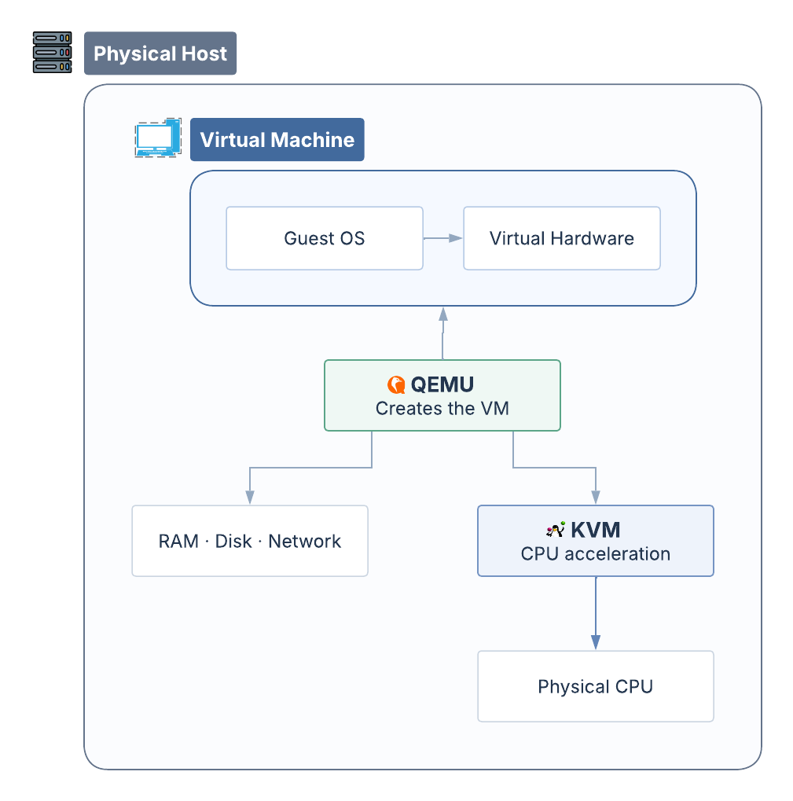

*Under the Hood #01 — QEMU, KVM và bí mật đằng sau những chiếc máy tính ảo.*

Bạn có bao giờ nghĩ rằng một chiếc máy tính có thể ra đời mà chẳng cần đến một con ốc vít nào?

Không mainboard mới. Không cắm thêm thanh RAM. Cũng chẳng có bộ xử lý nào được lắp vào. Ấy vậy mà, chỉ sau vài thao tác, một chiếc máy tính khác đã bắt đầu khởi động ngay bên trong chiếc máy đầu tiên. Nó có CPU, bộ nhớ, ổ đĩa và cả hệ điều hành riêng. Nó có thể truy cập Internet, chạy ứng dụng, thậm chí khởi động lại mà không ảnh hưởng chiếc máy bên ngoài.

<!-- truncate -->

Bạn nhìn quanh phòng. Chẳng có chiếc máy nào được đặt bên cạnh. Mọi thứ vẫn y như trước. Trên màn hình, một cửa sổ mới xuất hiện. Bên trong đó, một hệ điều hành khác đang hoạt động. Đằng sau chiếc máy tính ấy là một chương trình mang tên **QEMU**.

Thay vì lắp ráp những linh kiện vật lý, QEMU có thể tạo ra môi trường của một chiếc máy tính bằng phần mềm. Ổ cứng của máy ảo có thể chỉ là một file nằm trên ổ đĩa thật. Bộ nhớ được cung cấp từ RAM của máy thật. Ngay cả card mạng và những thiết bị khác cũng có thể được tạo ra dưới dạng ảo. Từ bên trong, hệ điều hành nhận diện và giao tiếp với những thiết bị ấy, chẳng khác mấy so với khi đang chạy trên một chiếc máy tính thông thường.

**Nhưng còn CPU thì sao?** Nếu bộ xử lý mà hệ điều hành nhìn thấy chỉ là một CPU ảo, vậy ai thực sự thực hiện những phép tính bên trong nó?

Hóa ra, QEMU còn có thể mô phỏng CPU bằng phần mềm. Một máy tính x86-64 có thể chạy một hệ thống dành cho kiến trúc ARM nhờ QEMU.

Hãy tưởng tượng hai người nói hai thứ tiếng khác nhau. Muốn hiểu nhau, họ cần một người phiên dịch. QEMU cũng làm điều tương tự với CPU: chuyển đổi những khối lệnh của hệ thống được mô phỏng thành mã mà máy thật có thể thực thi được.

**Nhưng nếu cả hai vốn đã nói cùng một ngôn ngữ, liệu người phiên dịch còn cần thiết nữa không?**

Nếu máy thật và máy ảo đều sử dụng kiến trúc x86-64, liệu có cách nào để CPU vật lý thực thi trực tiếp những lệnh ấy?

Đó chính là lúc **KVM** xuất hiện.

KVM, viết tắt của *Kernel-based Virtual Machine*, là một thành phần của Linux kernel. Nó tận dụng những tính năng ảo hóa của CPU vật lý, chẳng hạn Intel VT-x hoặc AMD-V, để nhiều lệnh của máy ảo được thực thi trực tiếp trên phần cứng thật, trong một môi trường được kiểm soát.

Vậy ra, QEMU và KVM không làm cùng một công việc.

**QEMU tạo và vận hành môi trường máy tính ảo, còn KVM giúp máy ảo tận dụng sức mạnh của CPU vật lý một cách hiệu quả hơn.**

*Minh họa khái niệm: QEMU cung cấp môi trường máy ảo, KVM tận dụng CPU vật lý.*

Nhờ sự phối hợp ấy, một hệ điều hành có thể hoạt động như thể nó đang sở hữu một chiếc máy tính riêng, dù thực chất vẫn chia sẻ tài nguyên với máy chủ bên ngoài.

Hóa ra, chẳng có thanh RAM hay CPU mới nào được thêm cả. Chúng ta chỉ đang chia sẻ những tài nguyên sẵn có, để nhiều hệ điều hành có thể hoạt động trên cùng một chiếc máy tính.

Nhưng liệu chiếc máy tính ảo ấy có thể tiếp tục tạo ra một chiếc máy tính bên trong chính mình không?

*Câu chuyện có lẽ vẫn chưa kết thúc.*
